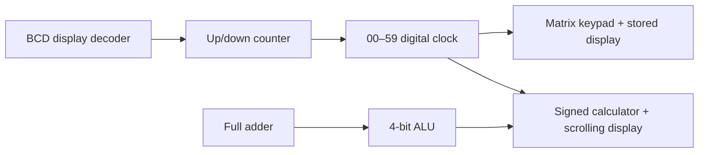

# EECS 270 · Digital Design Portfolio

[](https://github.com/Irati0nal/eecs270-digital-design/actions/workflows/simulation.yml)

Seven digital logic projects progressing from a gate-level full adder to an FPGA keypad interface and a signed accumulator with a scrolling display. Built around the **Digilent Basys 3 / Artix-7**, with **Verilog**, **Multisim**, **Vivado**, and self-checking simulations.

This portfolio grew out of my EECS 270 coursework (the supplied course materials use the title ECE2700J, Introduction to Logic Design). The published edition adds portable RTL references for the schematic projects, refactors the sequential designs, and supplies repeatable verification and build scripts. See [project provenance](docs/PROVENANCE.md) for the distinction between the original work and the portfolio edition.

## Projects

| Project | What it demonstrates | Verification |
| --- | --- | --- |
| [01 · Full adder](projects/lab01-full-adder) | Boolean equations, XOR propagation, carry generation | All 8 input combinations |
| [02 · Seven-segment driver](projects/lab02-seven-segment) | BCD decoding, active-low outputs, invalid-input handling | All 16 BCD input patterns |
| [03 · 4-bit ALU](projects/lab03-alu) | Addition, subtraction, carry/no-borrow, AND/OR selection | All 1,024 operation/operand combinations |
| [04 · Up/down counter](projects/lab04-counter) | Sequential state, wraparound, synchronization, button debounce | Bounce, hold, direction, rollover and reset |
| [05 · Digital clock](projects/lab05-digital-clock) | Clock enables, decimal cascaded counters, display multiplexing | Tick cadence, 00–59 rollover and digit outputs |
| [06 · Matrix keypad](projects/lab06-keypad) | Matrix scanning, frame debounce, event generation and storage | All 16 keys, hold/release and invalid multi-key frames |
| [07 · Digital device](projects/lab07-digital-device) | Signed datapath, overflow, mode control, scrolling messages | All 256 signed operand pairs plus top-level interaction |

## Design highlights

- **One clock domain:** sequential portfolio designs use the 100 MHz board clock with enables, avoiding button clocks and fabric-divided clocks.
- **Conditioned inputs:** asynchronous controls pass through synchronizers; push buttons produce one event per debounced press.
- **Shared display infrastructure:** a single active-low decoder and multiplexing driver serve the later projects, with one documented segment order.
- **Reproducible verification:** self-checking testbenches return a failure exit code; GitHub Actions runs the complete simulation suite.
- **Reproducible FPGA builds:** source files and pin constraints generate Vivado projects without machine-specific paths or checked-in caches.



## Run the simulations

Install Python 3 and Icarus Verilog (`iverilog` and `vvp`). On Ubuntu / WSL:

```sh
sudo apt-get update
sudo apt-get install -y iverilog python3
git clone https://github.com/Irati0nal/eecs270-digital-design.git
cd eecs270-digital-design
python3 scripts/test.py
```

Run selected projects with `python3 scripts/test.py 3 6 7`. On Windows, use `python scripts/test.py` with Icarus Verilog on PATH, or run the commands inside WSL. No Python packages are required. Simulation binaries go into the ignored `build/sim/` directory.

## Build for the Basys 3

From a Vivado command environment, run in the repository root:

```sh
vivado -mode batch -source scripts/build.tcl -tclargs 7 synth
vivado -mode batch -source scripts/build.tcl -tclargs 7 bitstream
```

Replace `7` with any number from `1` to `7`. The target is `xc7a35tcpg236-1`. Build outputs, reports, and the bitstream appear in `build/<project-name>/`. Open Vivado Hardware Manager and select the generated `.bit` file to program your connected board. See [hardware notes](docs/HARDWARE.md) for controls, wiring and timing assumptions.

## Repository guide

```text
projects/lab*/rtl/          Synthesizable project source
projects/lab*/sim/          Self-checking testbench
projects/lab*/constraints/  Basys 3 pin assignments
projects/lab0[1-3]*/multisim/ Original schematic artifacts
rtl/common/                Input conditioning and display components
scripts/                   Simulation and Vivado build entry points
docs/                      Provenance, verification and hardware notes
```

The original Multisim circuits are retained as binary artifacts. Their new RTL references are independently tested; the binary schematics have not been re-simulated or formally proven equivalent. The published RTL has not been exercised on a physical board during this cleanup. See [validation evidence](docs/VERIFICATION.md) for the exact checks and limits.

**Author:** [Yanzhe Yang](https://github.com/Irati0nal)
