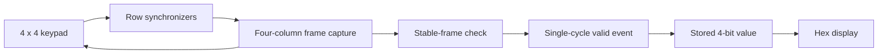

# 06 · 4 × 4 Keypad Scanner

Convert a physical matrix key into a debounced event and stored hexadecimal digit.

## Portfolio edition

The original column-search FSM is refactored into a full-frame scanner. Row inputs are synchronized, single-key frames must remain stable, and each accepted press emits one cycle of `valid`. A stable empty frame sequence re-arms the scanner.

## Behavior and controls



Key values are `4 × row + column`:

| | Col 0 | Col 1 | Col 2 | Col 3 |
| --- | --- | --- | --- | --- |
| Row 0 | 0 | 1 | 2 | 3 |
| Row 1 | 4 | 5 | 6 | 7 |
| Row 2 | 8 | 9 | A | B |
| Row 3 | C | D | E | F |

Rows connect to JA1..JA4; columns connect to JA7..JA10. Inputs use pull-downs, and columns are active-high. See the [wiring table](../../docs/HARDWARE.md). BTNC clears the stored digit. The rightmost display retains the last accepted key after release.

Default column dwell is 1 ms (`SCAN_CYCLES=100000`). A frame takes 4 ms. Five matching frames (`DEBOUNCE_FRAMES=5`) qualify a press or release. Detection latency depends on scan phase; do not interpret the frame interval as an exact fixed input latency. Use `SCAN_CYCLES >= 4` to allow synchronization to settle and `DEBOUNCE_FRAMES >= 1`.

This is a **single-key interface**. Multi-key sampled frames are rejected, but it is not a diode-isolated keyboard or a ghosting-proof multi-key design. Do not press multiple physical keys with opposing actively driven columns. Digital multi-key tests only check logic rejection.

## Run and build

From the repository root:

```sh
python3 scripts/test.py 6
vivado -mode batch -source scripts/build.tcl -tclargs 6 bitstream
```

Top module: [`top_keypad_system`](rtl/). Target: Basys 3 (`xc7a35tcpg236-1`). Pin assignments: [`constraints/basys3.xdc`](constraints/basys3.xdc).

## Verification

An electrical matrix model connects driven columns to rows. Tests press all 16 positions, reject a short glitch, verify one event per hold, retain data on release, reject a two-key frame, and reset the stored value.

The published edition has not been physically re-tested on a board. See [verification evidence](../../docs/VERIFICATION.md).

[Back to portfolio](../../README.md)
